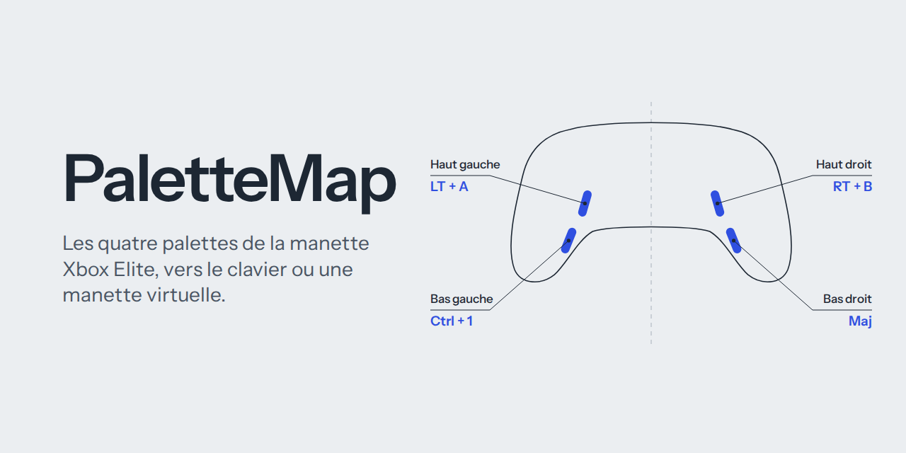

# PaletteMap

Application Windows qui affecte une touche clavier, ou une combinaison de boutons de manette, à chacune des quatre palettes arrière de la **manette Xbox Elite Series 1**. Les pilotes officiels de Microsoft ne permettent d'affecter aux palettes que des boutons de la manette elle-même ; PaletteMap lève cette limite, dans l'esprit de reWASD.

- Une affectation par palette : boutons de manette (par exemple `LT + A`), touche clavier avec Ctrl, Maj ou Alt (par exemple `Ctrl + 1`), ou les deux.
- Aucun remplacement du driver Xbox : la manette continue de fonctionner normalement dans les jeux.
- Fenêtre de réglages minimale, application discrète dans la zone de notification, lancement possible au démarrage de Windows.
- Reprise automatique après une mise en veille du PC ou un débranchement.

Page de présentation : [index.html](index.html) (publiable avec GitHub Pages).

## Comment ça marche

### Le problème

Sur l'Elite Series 1, Les palettes ne peuvent être assigné qu'aux seuls boutons de la manette. C'est une limitation des drivers de microsoft. Avec mon ami Claude, nous avons trouvé que les palettes étaient cependant bien assignées individuellement, ce qui nous a permis de mettre au point ce petit logiciel sans prétention, qui permet tout de même de supprimer une limitation matériel. Couplé au Driver Viegmbus, toutes les combinaison de bind de touches clavier ou manettes sont possible !

### Le principe

```
Manette Elite ──USB──> driver Xbox officiel ──> jeu        (inchangé)
      │
      └── USBPcap (lecture seule) ──> PaletteMap ──┬──> touche clavier ──> jeu
                                                   └──> manette virtuelle (ViGEmBus) ──> jeu
```

1. **Lire les palettes.** Une palette non assignée est invisible pour Windows, mais la manette continue d'envoyer son état sur le câble USB. PaletteMap le lit grâce au driver de capture **USBPcap**, sans rien modifier : le driver Xbox reste en place et la manette fonctionne normalement dans les jeux.
2. **Envoyer l'affectation.** Les touches clavier sont simulées directement par Windows. Les boutons de manette passent par une **manette Xbox 360 virtuelle** créée par le driver **ViGEmBus** ; elle reste muette en temps normal et n'envoie que ce que déclenchent les palettes.

Une application seule ne peut ni lire le trafic USB, ni créer une manette reconnue par les jeux : ces deux opérations passent par le noyau de Windows, d'où les deux drivers ci-dessous.

## Logiciels indispensables

Tous gratuits. **À réinstaller après une réinstallation de Windows**, dans l'ordre de la section Installation.

| Logiciel | Rôle | Obligatoire | Sans lui |
|---|---|---|---|
| [Accessoires Xbox](https://apps.microsoft.com/detail/9nblggh30xj3) (Microsoft Store) | Régler les palettes sur « Non assigné » | Oui, une fois | Les palettes restent des copies de A, B, X ou Y |
| [USBPcap](https://desowin.org/usbpcap/) | Lire l'état des palettes dans le trafic USB | **Oui** | Rien ne fonctionne : « USBPcap introuvable » |
| [ViGEmBus 1.22.0](https://github.com/nefarius/ViGEmBus/releases) | Créer la manette virtuelle | Pour les boutons de manette | Seules les touches clavier sont disponibles |
| PaletteMap | L'application elle-même | Oui | |

Le réglage « Non assigné » est enregistré dans la manette elle-même : il survit à une réinstallation de Windows et n'est à refaire que si vous changez de profil. Aucune installation de .NET n'est nécessaire, l'exécutable est autonome.

ViGEmBus a été archivé par son auteur en novembre 2023 et ne reçoit plus de mises à jour, mais il fonctionne toujours et reste utilisé par de nombreux outils (DS4Windows, etc.). Installez-le uniquement depuis sa page GitHub officielle.

## Prérequis

- Windows 10 ou 11, 64 bits.
- Manette Xbox Elite Series 1 **branchée en USB** (l'adaptateur sans fil n'a pas été testé).
- Droits administrateur (l'accès à USBPcap leur est réservé).

## Installation

### 1. Libérer les palettes dans Accessoires Xbox

Tant qu'une palette est assignée à un bouton, la manette la transforme elle-même en ce bouton et aucun logiciel ne peut la distinguer.

1. Installez **Accessoires Xbox** depuis le Microsoft Store, branchez la manette en USB et appliquez la mise à jour du micrologiciel si elle est proposée.
2. Créez un profil (ou modifiez-en un) et réglez les **quatre palettes sur « Non assigné »**.
3. Dans la liste déroulante en haut du profil, remplacez « Pas dans l'emplacement » par **l'emplacement 1** (ou 2).
4. Placez le **commutateur de profil** sur le devant de la manette sur ce même emplacement : le voyant correspondant s'allume en façade.
5. Fermez Accessoires Xbox.

### 2. Installer USBPcap (indispensable)

Au choix :

- téléchargez l'installateur depuis [desowin.org/usbpcap](https://desowin.org/usbpcap/) ;
- ou installez [Wireshark](https://www.wireshark.org/) en **cochant l'option « Install USBPcap »**, décochée par défaut. Npcap n'est pas nécessaire.

### 3. Installer ViGEmBus (pour les boutons de manette)

1. Ouvrez la [page des versions de ViGEmBus](https://github.com/nefarius/ViGEmBus/releases) et téléchargez l'installateur `.exe` de la version **1.22.0**, dans la rubrique Assets.
2. Lancez-le, acceptez les demandes de Windows, redémarrez si demandé.

Étape facultative si vous n'affectez que des touches clavier.

**Redémarrez le PC** après les étapes 2 et 3 : USBPcap et ViGEmBus ne sont actifs qu'après un redémarrage.

### 4. Installer PaletteMap

**Version compilée :** téléchargez `PaletteMap.exe` depuis la page [Releases](../../releases/latest) et placez-le dans un dossier définitif (par exemple `C:\Program Files\PaletteMap\`). L'exécutable est autonome, aucune installation de .NET n'est nécessaire.

Au premier lancement, Windows peut afficher un écran SmartScreen bleu, car l'exécutable n'est pas signé : cliquez sur **Informations complémentaires > Exécuter quand même**.

### 5. Premier lancement

1. Lancez `PaletteMap.exe` et acceptez la demande d'autorisation de Windows (les droits administrateur sont nécessaires pour lire le trafic USB).
2. Appuyez sur un bouton de la manette : la ligne d'état affiche **« Manette connectée »**.
3. Appuyez sur chaque palette : le témoin rond de la ligne correspondante se remplit.

## Utilisation

Un clic sur la capsule d'une palette ouvre son menu :

- **Boutons de manette** (LT, RT, LB, RB, A, B, X, Y, croix directionnelle, L3, R3, Vue, Menu) : ils se cochent sans fermer le menu, ce qui permet de composer une combinaison. Pour `LT + A`, cochez LT puis A, puis cliquez ailleurs.
- **Touche clavier…** : appuyez sur la touche voulue, en maintenant Ctrl, Maj ou Alt pour une combinaison. Ctrl, Maj ou Alt seuls sont aussi acceptés. Échap annule, Suppr retire la touche.
- **Tout effacer**.

La capsule affiche l'affectation, par exemple `LT + A` ou `Ctrl + 1`. Les réglages sont enregistrés automatiquement dans `%APPDATA%\PaletteMap\config.json`.

Fermer la fenêtre la masque : PaletteMap reste active dans la zone de notification (clic pour rouvrir, clic droit > Quitter). La case **« Lancer au démarrage de Windows »** crée une tâche planifiée qui démarre PaletteMap en arrière-plan à l'ouverture de session, avec les droits administrateur et sans demande de confirmation.

## World of Warcraft: Forever

Le mode manette (Alpha) de WoW Forever associe ses emplacements d'action à des combinaisons comme LT + A, différentes des raccourcis clavier. Affectez donc à la palette la combinaison de **boutons de manette** voulue : WoW la reçoit par la manette virtuelle.

Si une combinaison n'est pas reconnue, le délai entre la gâchette et le bouton se règle dans `Program.cs` :

```csharp
const int ModifierDelay = 25;   // ms
```

## Dépannage

| Symptôme | Cause probable | Solution |
|---|---|---|
| « USBPcap introuvable » | USBPcap absent (par exemple après une réinstallation de Windows), PC non redémarré, ou capture déjà ouverte par Wireshark | Installer USBPcap, redémarrer, fermer Wireshark |
| « Appuie sur un bouton de la manette » persiste | Aucun rapport de la manette reçu | Vérifier le câble USB, puis quitter et relancer PaletteMap |
| Les témoins ne réagissent pas, mais A, B, X ou Y s'activent | Palettes encore assignées | Refaire l'étape 1 : profil attribué à un emplacement, commutateur sur cet emplacement |
| Menu : « Manette virtuelle indisponible » | ViGEmBus absent ou PC non redémarré | La raison est affichée dans le menu ; installer ViGEmBus 1.22.0 puis redémarrer |
| Le démarrage automatique lance une ancienne version | La tâche planifiée pointe vers l'ancien fichier | Décocher puis recocher « Lancer au démarrage de Windows » |
| La compilation des sources échoue | Une instance de PaletteMap verrouille le fichier | Quitter PaletteMap, ou lancer `build.cmd` en administrateur |

## Limites

- Conçu et testé pour la **Xbox Elite Series 1 en USB**. La Series 2 et l'adaptateur sans fil utilisent d'autres formats de rapport, non pris en charge.
- Certains anti-triches refusent les entrées simulées ou les manettes virtuelles.

## Crédits

- [USBPcap](https://github.com/desowin/usbpcap), Tomasz Moń, licence BSD 2-Clause.
- [ViGEmBus](https://github.com/nefarius/ViGEmBus) et [ViGEm.NET](https://github.com/nefarius/ViGEm.NET), Nefarius Software Solutions.
- Police de la bannière : [Instrument Sans](https://fonts.google.com/specimen/Instrument+Sans), licence SIL Open Font License.

Projet indépendant, sans lien avec Microsoft, Xbox ou Blizzard.
